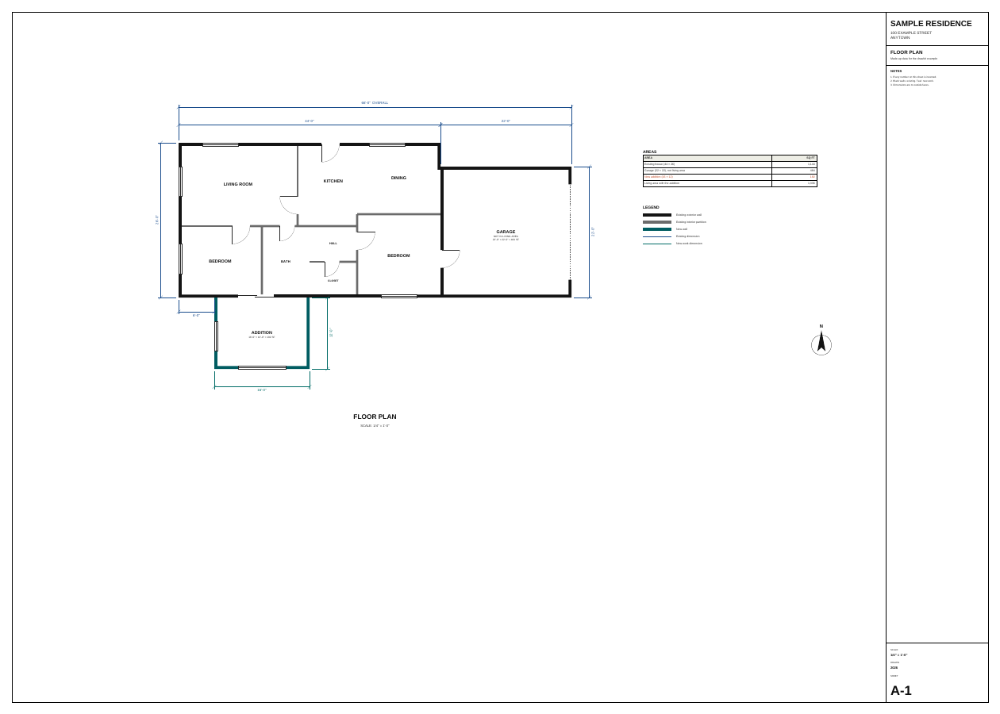
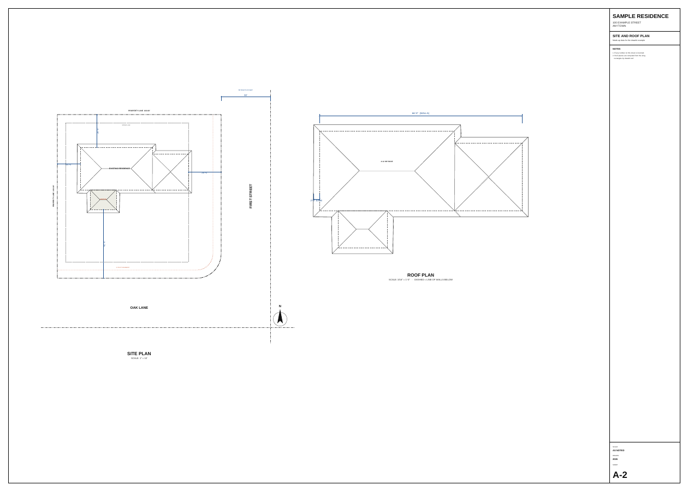

# adu_permit

`drawkit` is a small Python engine for drawing residential permit sheets — floor plans, site and roof plans,
elevations, details — as PDF and DXF from numbers in code. One command builds every sheet of a project, merges
them into a set, and checks the result.

It contains no real project. The bundled example is a made-up house.




## Run

```bash
pip install -r requirements.txt
python run.py                              # builds examples/sample_house into its output/ folder
python run.py path/to/project              # your own project
python run.py path/to/project --only A-1   # one sheet
```

Python 3.10 or newer. No system packages are needed; the fonts are bundled. Every push builds the sample on
GitHub Actions and attaches the PDFs and DXFs as the `sample-drawing-set` artifact.

## What the engine does

| Module | Purpose |
|---|---|
| `drawkit/core.py` | Primitives (`line`, `fill`, `text`), layers with line weights, `View` (feet to sheet inches at a scale), dimensions in feet and inches, room labels, tables, and `Floor`: a wall model that takes an outline, interior walls, doors and windows and draws the plan |
| `drawkit/roof.py` | Hip-roof plan from the rectangles of a building's wings: hips, ridges and valleys are computed |
| `drawkit/sheet.py` | Border, title strip, north arrow, legend |
| `drawkit/render.py` | Writes a sheet to PDF and DXF (one DXF layer per drawkit layer, real-world inches) |
| `drawkit/dxf2pdf.py` | Renders a sheet DXF to PDF with the same line weights, so a sheet can be maintained in CAD |
| `drawkit/forms.py` | Fills a fillable PDF form from a JSON file |
| `run.py` | The pipeline: build each sheet, merge the set, fill the form, check page size and DXF validity |

## A project

A project is a folder with a `project.py` that lists its sheets:

```python
SHEETS = [
    # id,   output stem,       kind,        source,                PDF title,     K
    ('A-1', 'A-1_floor_plan',  'generated', 'floor_plan',          'Floor Plan',  None),
    ('A-3', 'A-3_notes',       'dxf',       'sheets/A-3_notes.dxf', 'Notes',      48),
]
```

- **`generated`**: `source` is a Python module in the project folder. Importing it draws the sheet.
  Keep the building as data (outline polygons, wing rectangles) so other sheets can import it;
  in the example, `site_plan.py` takes the outline from `floor_plan.py`.
- **`dxf`**: `source` is a DXF you edit by hand. `K` is model inches per sheet inch: 48 for 1/4" = 1'-0",
  64 for 3/16", 8 for 1 1/2". Layer names are `<prefix>-<drawkit layer>`.

Optional in `project.py`: `TITLE_PREFIX`, `AUTHOR`, `SET_NAME`, and
`FORM = (blank.pdf, values.json, output name)`. A `layers.py` in the project folder can add layers with
`drawkit.core.add_layer`.

A minimal generated sheet:

```python
from drawkit.core import *
from drawkit import sheet

v = View(8, 6)                                   # sheet position of the model origin, in inches
f = Floor(v, [(0, 0), (30, 0), (30, 20), (0, 20)])   # outside outline, in feet
f.wall((12, 0), (12, 20))
f.door((12, 8), (12, 11), toward=(9, 9))
f.window((4, 0), (9, 0))
f.render()
dim(v, (0, 0), (30, 0), -3, ftin(30))
room(v, 6, 10, 'BEDROOM')
sheet.title_strip(sheet.frame(), 'PROJECT', ['ADDRESS'], 'FLOOR PLAN', scale='1/4" = 1\'-0"', sheet='A-1')
```

## Conventions

- Model units are feet, x to the right and y down the sheet. Sheet units are inches from the top-left corner.
- The default sheet is 42 × 30 in. and the default scale is 1/4" = 1'-0" (`core.set_scale` changes it).
- Layers carry meaning and line weight: `WALL-EXT`, `WALL-INT`, `WALL-NEW` on plans; `ELEV`, `ELEV-LT`, `ELEV-XL`
  on elevations; `PL`, `SETBK`, `ESMT`, `ROOF` on site plans; `DIM`, `NOTE`, `FLAG` for annotation.

## Limits

The engine draws what you give it. It does not check a design against a building or zoning code, and its output
is not a survey or a stamped drawing.

Fonts: Liberation Sans, SIL Open Font License 1.1 (see `fonts/`).
